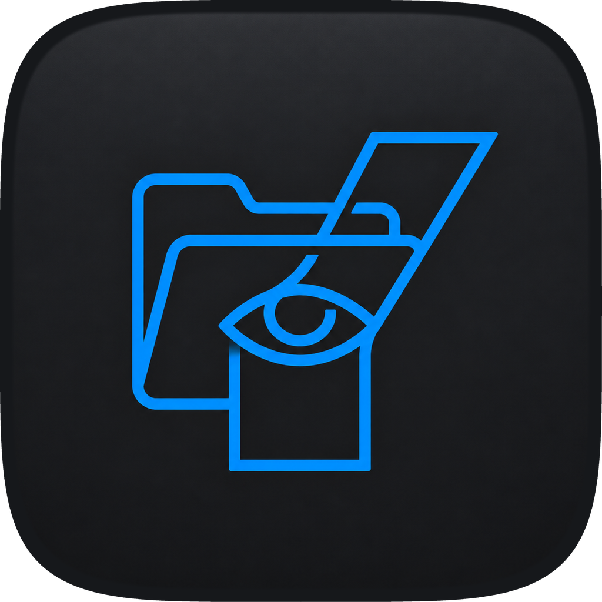

<p align="center">
  
</p>

<h1 align="center">YULA</h1>

<p align="center">
  Yerel dosya ve klasörlerde meydana gelen değişiklikleri izleyen dosya bütünlüğü denetim uygulaması.
</p>

## YULA nedir?

YULA, kullanıcının seçtiği dosya ve klasörlerin başlangıç durumunu kaydeden ve daha sonra oluşan değişiklikleri gerçek zamanlı olarak takip eden bir masaüstü uygulamasıdır.

Dosya içeriklerini SHA-256 özetiyle; erişim izni, sahiplik, boyut ve değiştirilme zamanı gibi bilgilerle birlikte değerlendirir. Tespit edilen olayları risk seviyesine göre sınıflandırarak kullanıcıya canlı arayüz üzerinden gösterir.

> YULA bir antivirüs değildir. File Integrity Monitoring (FIM) yaklaşımını temel alan yerel bir güvenlik izleme uygulamasıdır.

## Özellikler

- Birden fazla dosya ve klasörü izleme
- SHA-256 ile güvenilir referans durum oluşturma
- Dosya oluşturma, değiştirme, silme ve taşıma olaylarını algılama
- İzin, sahiplik ve sembolik bağlantı değişikliklerini takip etme
- Olayları düşük, orta ve yüksek risk olarak sınıflandırma
- Aynı içeriğe sahip yeni dosyaları olası kopya olarak belirleme
- Dosya ve desteklenen metin içeriklerinin panoya alınmasını izleme
- İzleme çalışmalarını ve olay geçmişini ayrı ayrı saklama
- Arama, filtreleme ve dosyaya göre gruplama
- Tarih ve saat aralığına göre PDF raporu oluşturma
- Arayüz kapatıldığında izlemeyi arka plan ajanıyla sürdürme

## Kurulum

### Gereksinimler

- macOS
- Python 3.11 veya üzeri
- Git

```bash
git clone https://github.com/ACerenDogan/Yula.git
cd Yula

python3 -m venv .venv
source .venv/bin/activate

python -m pip install --upgrade pip
python -m pip install -r requirements.txt
```

## Çalıştırma

```bash
python run.py
```

Uygulama açıldıktan sonra:

1. **Hedef Ekle** düğmesiyle izlenecek dosya veya klasörleri seçin.
2. **İzlemeyi Başlat** düğmesiyle yeni bir çalışma oluşturun.
3. Güvenlik olaylarını canlı akıştan veya dosyaya göre gruplanmış görünümden inceleyin.
4. **Rapor** bölümünden çalışma ve tarih aralığı seçerek PDF oluşturun.

Pencerenin kapatılması aktif izlemeyi sonlandırmaz. İzlemeyi tamamen bitirmek için **İzlemeyi Durdur** düğmesi kullanılmalıdır.

## Testler

```bash
python -m unittest discover -s tests -v
```

Projede dosya tarama, veritabanı, gerçek zamanlı izleme, pano takibi, arka plan ajanı, kullanıcı arayüzü ve PDF raporlama bölümlerini kapsayan **77 test** bulunmaktadır.

## Proje yapısı

```text
Yula/
├── run.py
├── requirements.txt
├── tests/
└── yula/
    ├── application/   # İzleme servisi ve arka plan ajanı
    ├── core/          # Tarama, SHA-256 ve risk değerlendirmesi
    ├── gui/           # PySide6 kullanıcı arayüzü
    ├── reporting/     # PDF raporlama
    └── storage/       # SQLite veritabanı işlemleri
```

## Kullanılan teknolojiler

- Python
- PySide6
- watchdog
- SQLite
- ReportLab
- unittest

## Güvenlik ve gizlilik

- Bütün olay kayıtları yerel SQLite veritabanında tutulur.
- Kopyalanan metnin kendisi veritabanına kaydedilmez.
- Veritabanı sembolik bağlantı üzerinden açılmaz.
- YULA’nın oluşturduğu veritabanı ve geçici dosyalar izleme dışında bırakılır.
- Olay tablosu salt okunurdur.

## Bilinen sınırlar

- Aynı SHA-256 değerine sahip yeni bir dosya olası kopyayı gösterebilir ancak kopyalama işlemini kesin olarak kanıtlamaz.
- Dosyanın panoya alınması, başka bir konuma yapıştırıldığını göstermez.
- Etkin kullanıcı bilgisi işlemi yapan kişiyi kesin olarak belirlemez.
- Bilgisayar kapalıyken gerçek zamanlı izleme yapılamaz.
- YULA ağ trafiğini, USB aktarımını, e-posta gönderimini veya uzaktan bağlantıları doğrudan izlemez.

## Geliştirici

**Ayşe Ceren Doğan**
